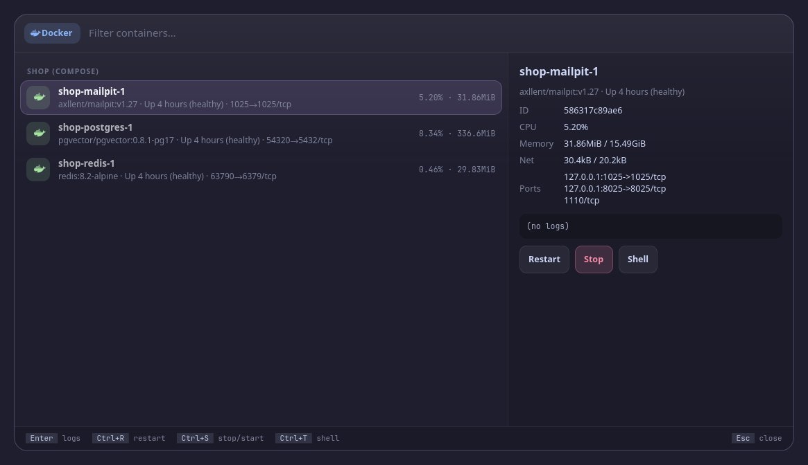

<p align="center">
  <picture>
    <source media="(prefers-color-scheme: dark)" srcset="assets/banner-dark.svg">
    <source media="(prefers-color-scheme: light)" srcset="assets/banner-light.svg">
    
  </picture>
</p>

<!-- identity -->
<p align="center">
  <b>विद्या ददाति विनयं विनयाद्याति पात्रताम् ।<br>
  पात्रत्वाद्धनमाप्नोति धनाद्धर्मं ततः सुखम् ॥</b><br>
  <i>Knowledge gives humility, humility makes one a worthy vessel, and from that come wealth, right action and joy.</i><br>
  <sub>Hitopadeśa, Prastāvikā 6</sub>
</p>
<!-- /identity -->

<p align="center">
  <b>Docker containers: grouped by compose project, live CPU and memory, logs in the preview; restart, stop, start, shell, logs.</b><br>
  Docker containers. A tool for <a href="https://github.com/Theyashsawarkar/vyom">Vyom</a>, keyboard-driven panels for Wayland.
</p>

<p align="center">
  <a href="https://github.com/Theyashsawarkar/patra/actions/workflows/ci.yml"></a>
  <a href="https://github.com/Theyashsawarkar/patra/releases"></a>
  <a href="LICENSE"></a>
  <a href="https://github.com/Theyashsawarkar/vyom"></a>
  
  
</p>

<!-- No screenshot: docker shows personal data (your own containers). -->

<p align="center">
  
</p>
<p align="center"><sub>Screenshots use made-up demo containers.</sub></p>

> *Patra* (पात्र) is Sanskrit for "vessel": the vessels your apps run in: containers.

patra is docker containers for [Vyom](https://github.com/Theyashsawarkar/vyom): one keyboard-driven panel that opens instantly, with live data, a preview and a key for everything. It runs on any compositor with the layer-shell protocol (sway, Hyprland, river, niri, Wayfire, labwc…). In [Vayu](https://github.com/Theyashsawarkar/vayu), the desktop it was built for, it replaces docker-picker.py.

## Contents

- [Features](#features)
- [Install](#install)
- [Usage](#usage)
- [Configuration](#configuration)
- [Troubleshooting](#troubleshooting)
- [The Vyom family](#the-vyom-family)
- [Contributing](#contributing)
- [License](#license)

## Features

- **A summary at the top**: how many containers run, how many are unhealthy (red) and how many are stopped.
- Every container, **grouped by compose project**, each project with a note ("needs you", "all running", "stopped"); **the ones that need you come first**: unhealthy, restarting or failed, in red, with "restarted 3× in 10 min" when Docker's events say so.
- **Live CPU and memory sparklines** on every running container (the last readings, kept while Vyom runs), with the current numbers.
- The preview shows the image and ports, and the **last log lines in colour**: ERROR red, WARN yellow, INFO green, times dimmed.
- Buttons with their keys: **Restart** (`R`), **Shell** (`o`), **Logs** (`Enter`), **Stop** in red (`x`; on a stopped one Start); **Remove** a stopped one with `dd`, which asks first (`y` removes).
- **Vim keys** (Vyom 0.7): NORMAL and INSERT modes, counts, `Space` as the leader with a which-key strip, `?` for every key and `Space Space` for a palette of every action. Filter (`Space f`: running, stopped, the ones that need you) and sort (`Space s`: CPU, memory, name).
- Never wakes a stopped Docker daemon (it's often socket-activated): it says it's stopped instead.
- Keyboard first: every action has a key, shown in the footer; the mouse works too.
- Never freezes the panel: slow commands run in the background.

## Install

### Requirements

- [Vyom](https://github.com/Theyashsawarkar/vyom) 0.7 or newer (Python 3.11+, PyGObject, GTK 4, [gtk4-layer-shell](https://github.com/wmww/gtk4-layer-shell), a Nerd Font)
- `docker`

### Install

```sh
git clone https://github.com/Theyashsawarkar/patra ~/.local/share/vyom/plugins/patra
vyom reload           # pick it up (or log out and in)
vyom patra            # open it; run it again to close
```

Give it a key in your compositor, e.g. sway:

```sh
bindsym $mod+<key> exec vyom patra
```

### Update and uninstall

```sh
git -C ~/.local/share/vyom/plugins/patra pull && vyom reload     # update
rm -rf ~/.local/share/vyom/plugins/patra && vyom reload          # uninstall
```

## Usage

Open it with `vyom patra` (or your key). It opens in NORMAL mode, where every letter is a key and typing changes nothing: `j` / `k` move, `Enter` follows the logs, `x` stops or starts, `dd` removes (it asks), `/` types a filter (INSERT mode; `Esc` goes back). `Space` is the leader: wait a moment after it and a strip shows what comes next.

<!-- KEYS (generated by scripts/keybinds.py from patra/vim.py) -->

Vyom's vim keys work too: `?` and `Space ?` list every key, `Space Space` is the palette, `q` closes, `Esc` steps back, `Space u f` is fullscreen, `Space r` refreshes, `j` / `k` move, `gg` / `G` jump, `/` searches.

**Normal mode (where it opens; `/` types a filter)**

| Key | Action |
|---|---|
| `Enter` | Follow the selected container's logs in a terminal |
| `o` | Open a shell in the selected container |
| `x` | Stop the selected container, or start a stopped one |
| `R` | Restart the selected container |
| `d d` | Remove the selected stopped container (y confirms) |
| `y y` | Copy the container's name |
| `r` | Reload the list now |

**Leader (Space)**

| Key | Action |
|---|---|
| `Space c r` | Restart the selected container |
| `Space c s` | Stop the selected container, or start a stopped one |
| `Space c l` | Follow the selected container's logs in a terminal |
| `Space c h` | Open a shell in the selected container |
| `Space o t` | Open a shell in the selected container, in a terminal |
| `Space y y` | Copy the container's name |
| `Space y i` | Copy the container's ID |
| `Space y p` | Copy the container's ports |
| `Space f r` | Show only running containers (again: show all) |
| `Space f s` | Show only stopped containers (again: show all) |
| `Space f t` | Show only the ones that need you (again: show all) |
| `Space f c` | Clear the filter: show every container |
| `Space s c` | Sort the containers by CPU (busiest first; again: the usual order) |
| `Space s m` | Sort the containers by memory (biggest first; again: the usual order) |
| `Space s n` | Sort the containers by name (A to Z; again: the usual order) |
| `Space d d` | Remove the selected stopped container (y confirms) |

Keys that moved in this release still say where they went:
`Ctrl+l` → `Enter`, `Ctrl+Backspace` → `d d`.

<!-- END KEYS -->

## Configuration

Everything is optional, in `~/.config/vyom/config.toml` under `[plugin.patra]`:

| Setting | Default | What it does |
|---|---|---|
| `terminal` | $TERMINAL, else kitty/foot/alacritty/wezterm | Terminal for logs and shells |

Run `vyom reload` after editing.

## Troubleshooting

- **Nothing opens.** `vyom list` shows every installed tool, and why one is skipped (a missing requirement, or a Vyom that's too old).
- **It opened, then something failed.** Look for a `Traceback` in the daemon's log, `journalctl --user -u vyom -u vyom-daemon -b` (without systemd: `~/.local/state/vyom/daemon.log`), and [open an issue](https://github.com/Theyashsawarkar/patra/issues/new/choose) with it.
- **No blur or rounded corners.** That's the compositor: on SwayFX, add `layer_effects "vyom" { blur enable; corner_radius 20; shadows enable }`.

## The Vyom family

Each tool is its own repository, so you install only the ones you want:

| Tool | | What it does |
|---|---|---|
| [dvara](https://github.com/Theyashsawarkar/dvara) | द्वार, gateway | The app launcher |
| [ganit](https://github.com/Theyashsawarkar/ganit) | गणित, mathematics | The calculator and converter |
| [smriti](https://github.com/Theyashsawarkar/smriti) | स्मृति, memory | Clipboard history |
| [bhava](https://github.com/Theyashsawarkar/bhava) | भाव, feeling, emotion | The emoji picker |
| [tarang](https://github.com/Theyashsawarkar/tarang) | तरंग, wave | Wi‑Fi and the hotspot |
| [setu](https://github.com/Theyashsawarkar/setu) | सेतु, bridge | Bluetooth |
| [doot](https://github.com/Theyashsawarkar/doot) | दूत, messenger | Your phone, through KDE Connect |
| [patra](https://github.com/Theyashsawarkar/patra) (this one) | पात्र, vessel | Docker containers |
| [akashvani](https://github.com/Theyashsawarkar/akashvani) | आकाशवाणी, voice from the sky | Notifications |
| [raga](https://github.com/Theyashsawarkar/raga) | राग, melody | YouTube music and video |
| [mudra](https://github.com/Theyashsawarkar/mudra) | मुद्रा, gesture | Keybinding search |
| [urja](https://github.com/Theyashsawarkar/urja) | ऊर्जा, energy | The battery at a glance |
| [vishram](https://github.com/Theyashsawarkar/vishram) | विश्राम, rest | The power menu |
| [kendra](https://github.com/Theyashsawarkar/kendra) | केन्द्र, centre | Quick settings |

## Contributing

Bug reports, ideas and pull requests are welcome: see [CONTRIBUTING.md](CONTRIBUTING.md) for the development setup and the few rules every tool follows, and [CHANGELOG.md](CHANGELOG.md) for what changed in each release. Please report security issues privately ([SECURITY.md](SECURITY.md)).

## License

[MIT](LICENSE).
